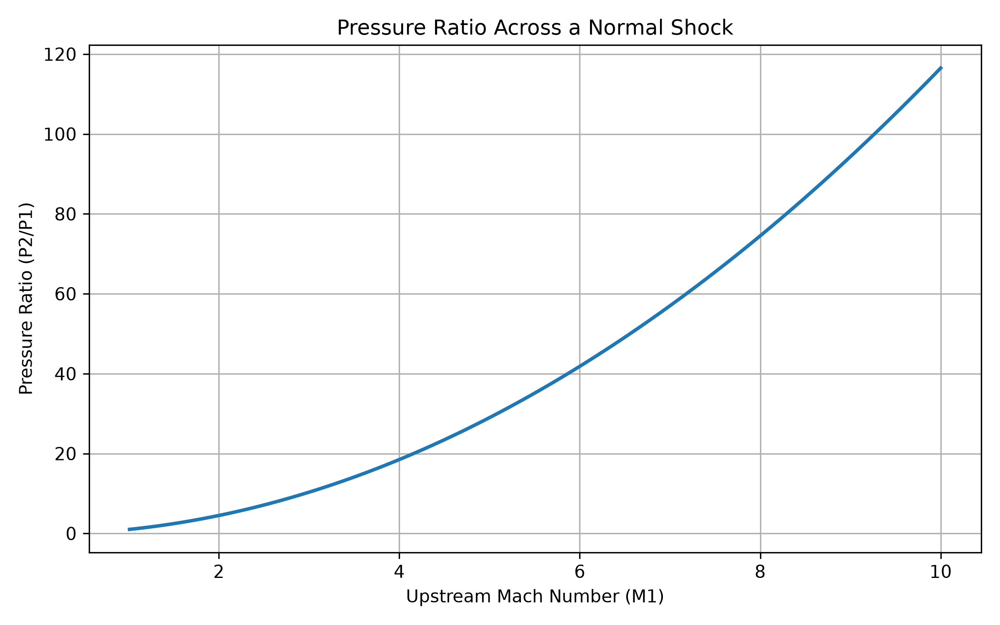
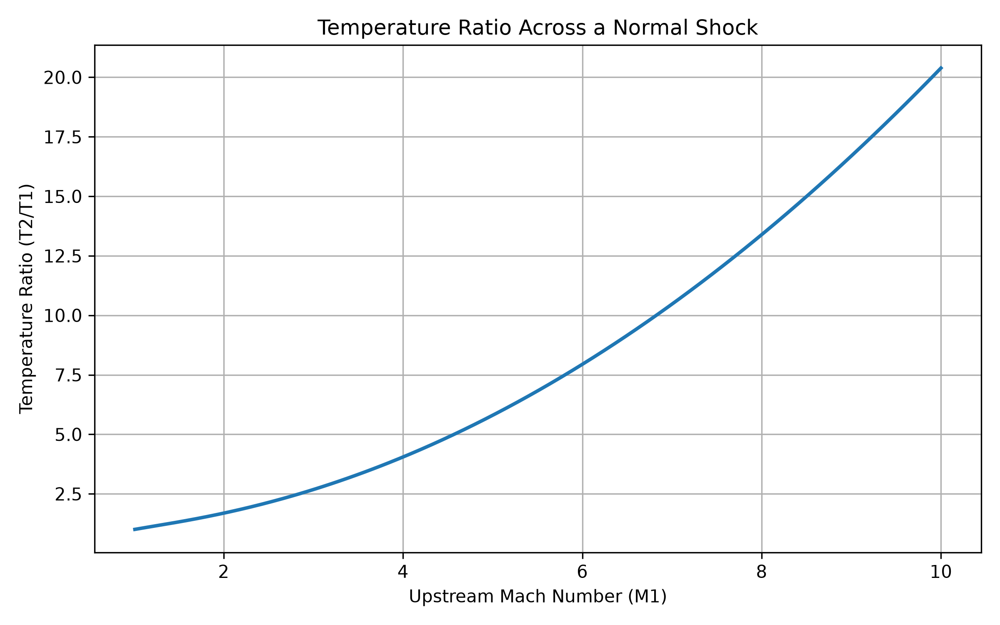
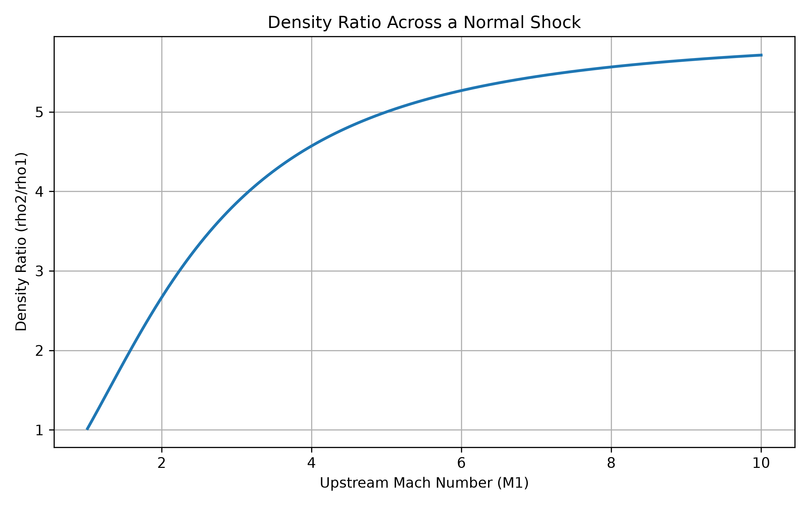
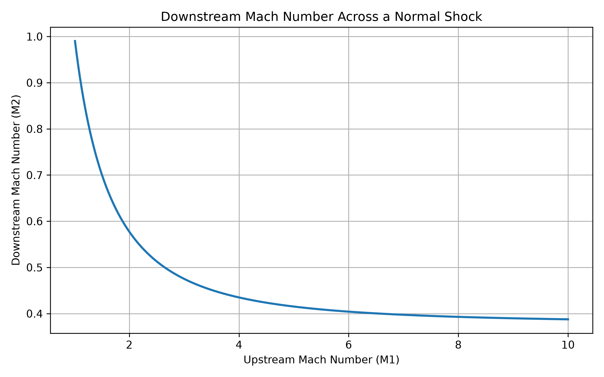
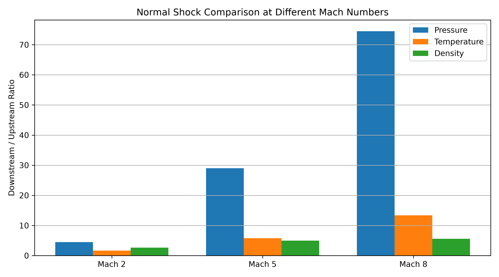
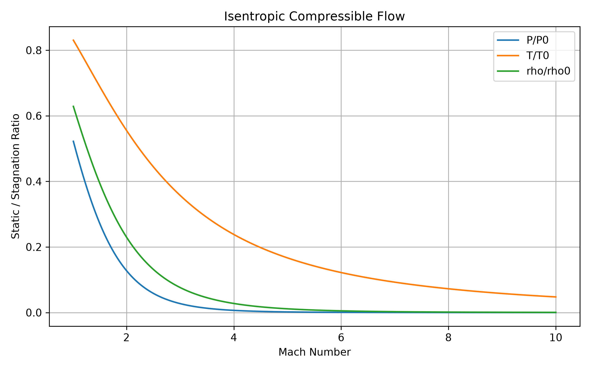

# Supersonic Flow & Shock Wave Calculator

**Python-based computational physics project | Aerospace and Compressible Flow**

## Project Overview

This project uses Python to model how air behaves when passing through a normal shock wave at supersonic and hypersonic speeds.

The calculator determines changes in pressure, temperature, density, velocity, and Mach number across a shock wave. It also generates graphs to visualize these changes over a range of Mach numbers. Users can enter their own Mach number, pressure, and temperature to calculate airflow properties before and after a normal shock wave.

The project was developed independently to apply physics, mathematics, and programming skills to an aerospace-related problem.

## Physics and Mathematical Model

The program uses the normal shock relations for an ideal gas.

The main quantities calculated are:

- Pressure ratio: P₂/P₁
- Temperature ratio: T₂/T₁
- Density ratio: ρ₂/ρ₁
- Downstream Mach number: M₂
- Upstream and downstream velocities

Here, subscript 1 represents conditions before the shock wave, while subscript 2 represents conditions after the shock wave.

The project also includes isentropic-flow calculations comparing static pressure, temperature, and density with their stagnation values.

## Assumptions

The calculations use the following assumptions:

- Air behaves as an ideal gas.
- The ratio of specific heats is constant at γ = 1.4.
- The specific gas constant is R = 287.05 J/(kg·K).
- The shock wave is stationary and perpendicular to the airflow.
- Flow is steady and one-dimensional.
- The model does not account for real-gas effects, chemical reactions, or detailed aircraft geometry.

The example calculations use an upstream pressure of 101325 Pa and temperature of 288.15 K, approximately corresponding to standard sea-level atmospheric conditions. Users can specify different upstream conditions when running the calculator.

At very high temperatures, particularly under hypersonic conditions, the constant-specific-heat assumption becomes less accurate.

## Results

The model was used to investigate airflow at Mach 2, Mach 3, Mach 5, and Mach 8.

| Upstream Mach | Pressure Ratio | Temperature Ratio | Density Ratio | Downstream Mach |
|---|---|---|---|---|
| 2 | 4.500 | 1.688 | 2.667 | 0.577 |
| 3 | 10.333 | 2.679 | 3.857 | 0.475 |
| 5 | 29.000 | 5.800 | 5.000 | 0.415 |
| 8 | 74.500 | 13.387 | 5.565 | 0.393 |

The results show that pressure, temperature, and density increase across a normal shock, while the downstream Mach number decreases below 1.

## Visualizations

The project generates six graphs showing:

1. Pressure ratio versus upstream Mach number
2. Temperature ratio versus upstream Mach number
3. Density ratio versus upstream Mach number
4. Downstream Mach number versus upstream Mach number
5. Comparison of Mach 2, Mach 5, and Mach 8
6. Isentropic compressible-flow ratios

### Pressure Ratio



### Temperature Ratio



### Density Ratio



### Downstream Mach Number



### Mach Number Comparison



### Isentropic Flow



## Validation

The calculator was tested at multiple Mach numbers against reference values calculated using the normal shock equations published by NASA Glenn Research Center.

The validation script, `validate.py`, compares calculated pressure, temperature, density, and downstream Mach ratios against these reference values. All tested Mach numbers passed validation within the specified numerical tolerance.

[Reference: NASA Glenn Research Center — Normal Shock Wave Equations](https://www.grc.nasa.gov/WWW/BGH/normal.html)

## How to Run

Install the required Python libraries:

```bash
python -m pip install -r requirements.txt
```

Run the interactive shock-wave calculator:

```bash
python shock_calculator.py
```

Generate the graphs:

```bash
python shock_graphs.py
```

Run the validation tests:

```bash
python validate.py
```

The generated graphs are saved in the `figures` folder.

## Applications

Normal shock-wave calculations are relevant to understanding high-speed airflow in aerospace engineering, including changes in pressure, temperature, density, and Mach number.

These effects are important when studying supersonic and hypersonic vehicles, aerodynamic heating, and compressible-flow behaviour.

This project is an introductory computational model rather than a complete simulation of airflow around an aircraft.
